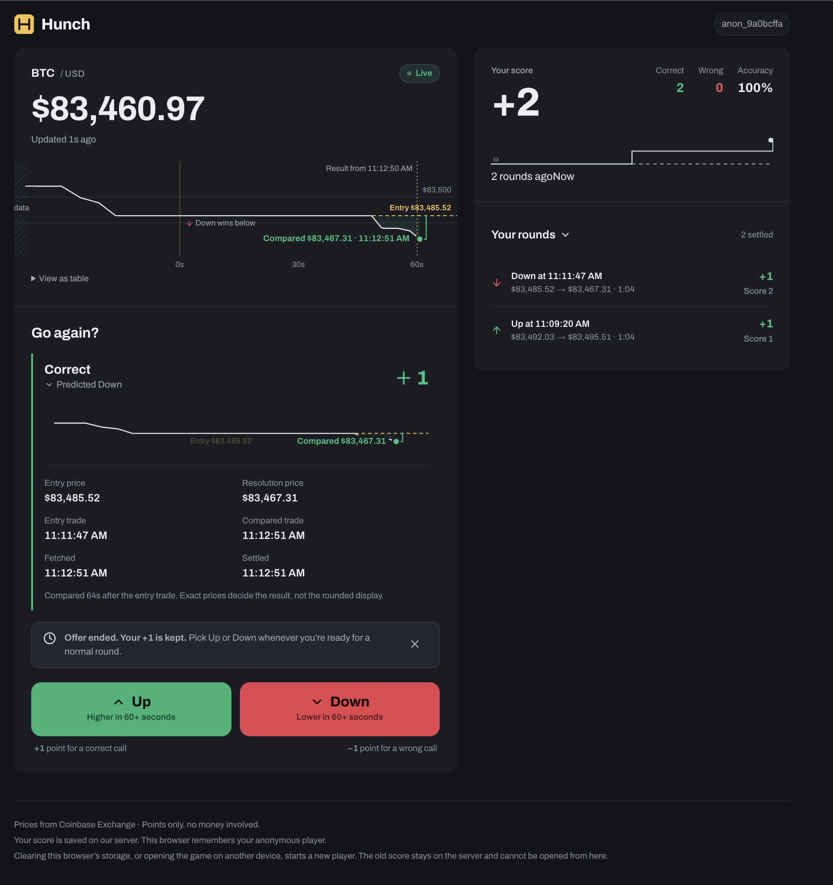
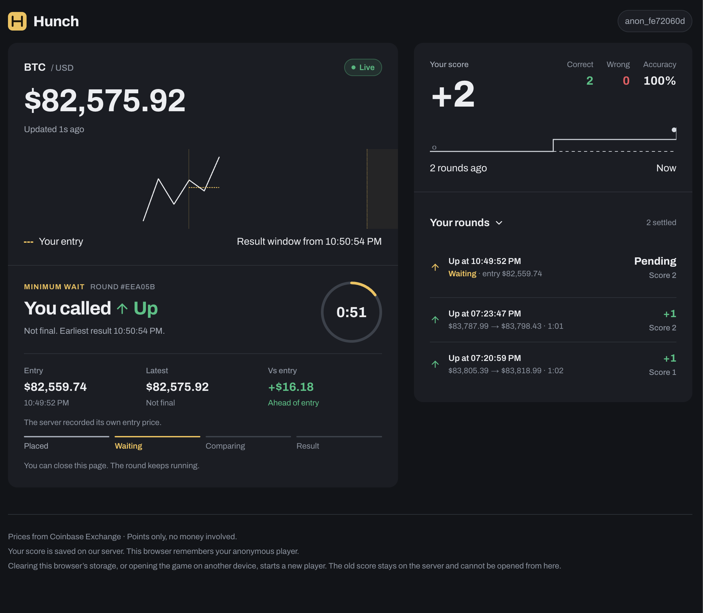
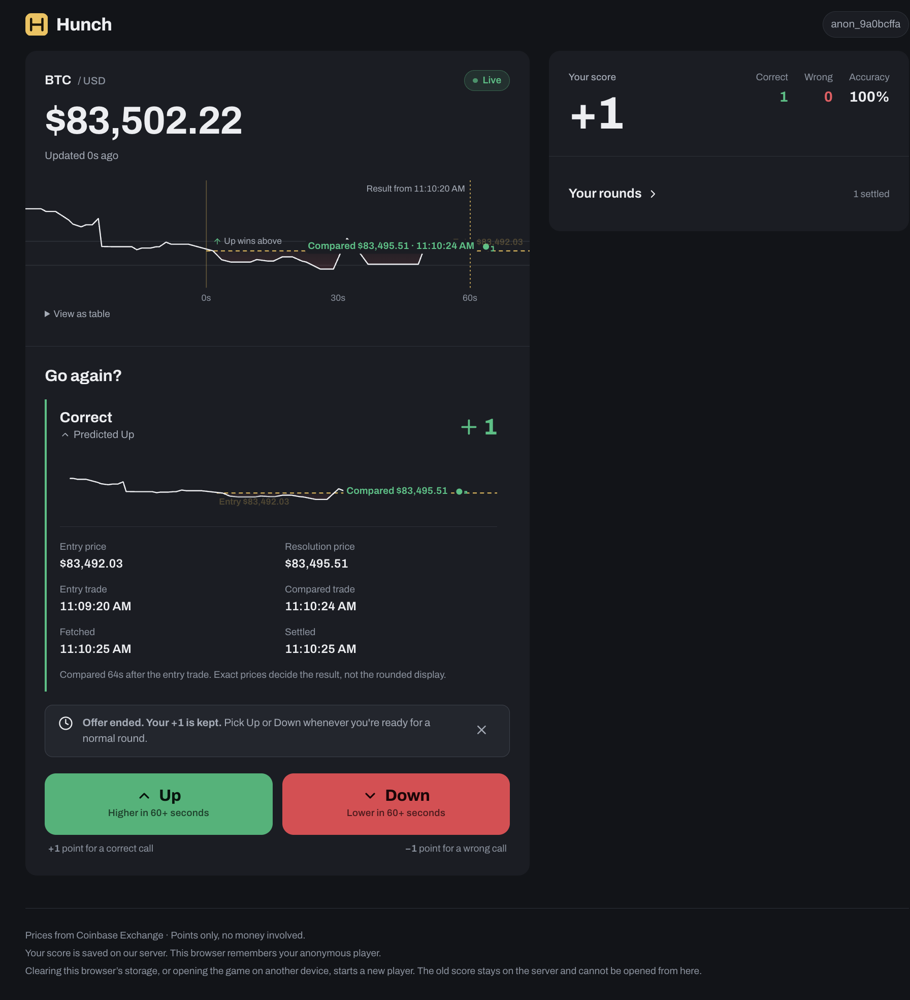
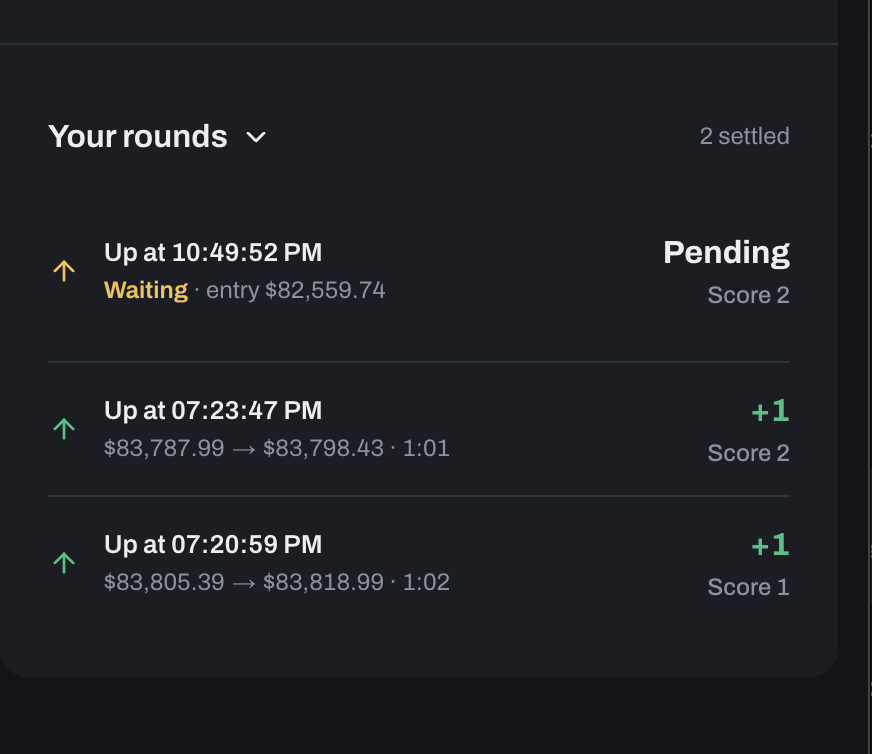
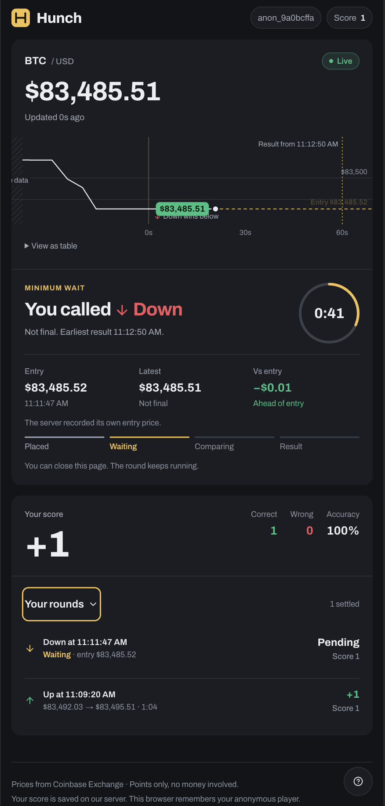

# Hunch — BTC/USD higher or lower

A small web game built for the epilot coding assignment. You guess whether the Bitcoin price (BTC/USD) will be higher or lower after at least one minute. The server records your entry price, waits, compares prices fairly and keeps your score, even if you close the browser.

- **Play it:** https://release.d2yczmbttcpoe9.amplifyapp.com
- **Repository:** https://github.com/MarioAslau/ePilot
- **API health check:** https://6n3p7430tg.execute-api.eu-north-1.amazonaws.com/health
- **More detail:** [architecture and decisions](docs/architecture.md) · [ticket plan and diary](docs/implementation-plan.md)

**Quick start:** open the hosted link, or run `yarn install && yarn dev:local` locally. No AWS account is needed.

## How to play

1. Open the site. You get an anonymous player at score 0, with no sign-up.
2. Watch the live price and chart, then press **Up** or **Down**. The server locks a fresh entry price and starts a 60-second minimum wait.
3. After the countdown, the round shows **Comparing prices** until the server confirms a result. The receipt shows **Correct** (+1) or **Not this time** (−1), both prices and both trade times.
4. Settled rounds are listed under **Your rounds**. Close the tab at any time: the round still settles, and your score is there when you come back in the same browser.

| | |
|---|---|
|  |  |
| Ready to play | A running round |
|  |  |
| Result receipt | History |



## How the brief is met

| Requirement | How it is met |
|---|---|
| Current score and latest BTC/USD price always visible | Score from `GET /me`; price from `GET /market` (Coinbase BTC-USD ticker), polled about every 5 s with a Live / Delayed / Unavailable state. |
| Guess up or down | `POST /predictions`. The server fetches its own entry price and never trusts one from the browser. |
| One guess at a time | A DynamoDB transaction locks the player while a round is open, so two tabs or a double click get `409 ACTIVE_ROUND`. |
| Resolve after the price changed **and** ≥ 60 s passed | A Step Functions workflow waits until entry + 60 s, then compares a fresh trade whose timestamp is also ≥ 60 s after entry. An equal price waits 5 s and checks again. |
| +1 correct, −1 wrong; new players start at 0 | `evaluate()` in `packages/contracts/src/evaluator.ts` compares exact decimal strings. One conditional transaction settles each round exactly once. |
| Fair third-party prices | Coinbase Exchange. Responses are validated, time out after 3 s, and must be under 10 s old. A provider outage pauses the round and never counts as a loss. |
| Score persisted in a backend (AWS preferred) | DynamoDB, written by Lambda behind API Gateway. |
| Optional: close the browser and come back | An anonymous id and token in `localStorage`; `GET /me` restores the score, any running round and the latest result. |
| Testing | Unit, handler, component, DynamoDB Local and Playwright tests, run in GitHub Actions. See [Tests](#tests). |

## How it works

```
Browser (React, AWS Amplify Hosting)
   │  polls GET /market (~5 s) and GET /me (1–3 s)
   ▼
API Gateway HTTP API ──► Lambda handlers ──► DynamoDB (players, rounds, offers)
                              │
          POST /predictions   │  1. fetch a fresh Coinbase entry price
                              │  2. one transaction: save round + lock player
                              │  3. start a Step Functions execution
                              ▼
                 Step Functions Standard: wait until deadline
                              │
                              ▼
                 Resolver Lambda: fresh Coinbase trade
                   · equal price      → wait 5 s, try again
                   · provider failure → wait 15 s, try again (never a loss)
                   · differs          → one transaction: result + score + unlock

EventBridge schedule (every 5 min) ──► recovery Lambda restarts any round whose workflow is missing
```

- **Fairness:** the server owns every price and timestamp; the browser's price is display only.
- **Reliability:** one active round per player is a DynamoDB condition, guesses carry an idempotency key so retries return the same round, and settlement is conditional so it cannot count twice. CloudWatch alarms cover failed workflows and Lambda errors.
- **Identity:** no accounts. `POST /players` returns a random 256-bit token once; the server stores only its SHA-256 hash.
- **Stack:** React, TypeScript, Vite, Tailwind CSS, TanStack Query, Zod · AWS Lambda, API Gateway, DynamoDB, Step Functions, EventBridge, CloudWatch, SNS · Serverless Framework v4 · AWS Amplify Hosting · Vitest, React Testing Library, Playwright · GitHub Actions.

### Optional modes

Beyond the brief, each behind its own deploy flag (off by default, on in the hosted build). Standard rounds always score ±1.

- **Momentum Double Down:** after a win, one bonus round in the same direction: +2 / −2 (pair total +3 or −1).
- **Redemption:** after a loss, one round in a direction you choose: +4 / −2 (pair total +3 or −3).

Offers last 10 seconds; **Need more time?** adds 20 seconds, up to 10 times. Follow-on rounds still wait at least 60 seconds and never create another offer.

## Run locally

**Prerequisites:** macOS, Linux or WSL on Windows; Node.js 20+; Yarn Classic 1.22 (`npm install -g yarn`); Git.

```bash
git clone https://github.com/MarioAslau/ePilot.git
cd ePilot
yarn install
yarn dev:local
```

The app opens at http://localhost:5173. The port is fixed because the API's CORS rule and the fault-switch URL depend on it; if it is in use, the command stops and can be re-run once the port is free. `yarn dev:local` runs the real API handlers in memory inside the Vite dev server, with real Coinbase prices and real 60-second rounds. Both optional modes are on (set `FEATURE_DOUBLE_DOWN=off` or `FEATURE_REDEMPTION=off` to hide one). Data is lost when the command stops; if the browser then reports that its player was rejected, **Start a new player** resolves it.

To run the frontend against a deployed API instead, copy `.env.example` to `.env` in the repository root, set `VITE_API_BASE_URL`, and run `yarn dev`.

**Testing states locally.** `?fixture=<name>` renders one screen with fixed data, for example `?fixture=win`, `loss`, `history`, `dd-offer` or `rd-offer`; the banner lists every name. To force a failure on the next round, arm a dev-only fault:

```bash
curl -X POST http://localhost:5173/api/__dev/next-prediction \
  -H 'Content-Type: application/json' \
  -d '{"mode":"equal-price"}'
```

Modes: `provider-down`, `drop-response`, `equal-price`, `resolution-provider-down`, `next-resolution-win`, `next-resolution-loss`. Neither fixtures nor faults exist in the production build.

## Tests

```bash
yarn run check                                      # typecheck, lint, unit/component tests, build
yarn workspace web exec playwright install chromium # first time only
yarn workspace web e2e                              # browser journey, mocked API and clock
```

- `packages/contracts`: schemas and the decimal-safe scoring rules.
- `apps/api`: handlers with injected clocks and quotes (identity, idempotency, settlement, recovery, offers, no tokens in logs).
- `apps/web`: React Testing Library tests for every round, result, history and offer state.

DynamoDB race tests (concurrent creates, double settlement, offer vs. normal round) need DynamoDB Local and are skipped without `DYNAMODB_ENDPOINT`:

```bash
docker run --rm -p 8000:8000 amazon/dynamodb-local
DYNAMODB_ENDPOINT=http://localhost:8000 AWS_ACCESS_KEY_ID=local AWS_SECRET_ACCESS_KEY=local AWS_REGION=eu-north-1 \
  yarn workspace api test:int
```

CI (`.github/workflows/ci.yml`) runs `check`, the DynamoDB race tests and the Playwright journey on every push and pull request.

## Deploy your own copy

**Prerequisites:** the local setup above; an AWS account with the AWS CLI configured for a non-root IAM user that can create CloudFormation stacks, Lambda, API Gateway, DynamoDB, Step Functions, EventBridge, CloudWatch, SNS and IAM roles; a free Serverless Framework v4 account (`yarn serverless login` in `apps/api`, or `SERVERLESS_ACCESS_KEY`); and a fork of this repository.

### 1. Backend

```bash
cd apps/api
yarn serverless deploy --stage dev --region eu-north-1 \
  --param amplifyOrigin=https://<your-amplify-domain> \
  --param alarmEmail=<you@example.com> \
  --param doubleDown=on \
  --param redemption=on
```

This creates the DynamoDB table `hunch-<stage>`, the Lambdas, the HTTP API, the state machine, the recovery schedule, and the alarms with their SNS topic. It prints the API URL. `yarn serverless package …` validates without deploying.

| Setting | Where | Default | Meaning |
|---|---|---|---|
| `amplifyOrigin` | deploy param | `http://localhost:5173` | Origin allowed by CORS (localhost is always allowed). |
| `alarmEmail` | deploy param | none | Alarm email. Confirm the email AWS sends. |
| `doubleDown` / `redemption` | deploy param → `FEATURE_*` Lambda env | `off` | Optional modes. Locally on unless set to `off`. |
| `VITE_API_BASE_URL` | frontend build | empty | API Gateway URL, no trailing slash. `yarn dev:local` sets it to `/api`. |

No secrets live in the repository.

### 2. Frontend (AWS Amplify Hosting)

1. In the Amplify console, create an app from your fork. Keep the app root at the repository root; `amplify.yml` builds the workspace and publishes `apps/web/dist`. If Amplify requests a monorepo root, set `AMPLIFY_MONOREPO_APP_ROOT=.`.
2. Set the environment variable `VITE_API_BASE_URL` to the API URL from step 1.
3. Add the single-page-app rewrite (Hosting → Rewrites and redirects): source `</^[^.]+$|\.(?!(css|gif|ico|jpg|js|png|txt|svg|woff|woff2|ttf|map|json|webp)$)([^.]+$)/>`, target `/index.html`, type `200 (Rewrite)`.
4. Build. If the Amplify domain was not known in step 1, redeploy the backend with `--param amplifyOrigin=https://<your-amplify-domain>`, or the browser shows **Backend unreachable**.

### 3. Check and remove

```bash
curl https://<api-id>.execute-api.<region>.amazonaws.com/health   # {"status":"ok"}
```

Play a round, close the tab, reopen after a minute and confirm the result is there. To remove the stack, run `yarn serverless remove --stage dev --region eu-north-1` in `apps/api`. The DynamoDB table is kept on purpose; delete it in the DynamoDB console when it is no longer needed. Everything is pay-per-use, so light use stays near zero cost.

## Repository structure

```
apps/web             React frontend (Vite); local in-memory API wired in vite.config.ts
apps/api             Lambda handlers, DynamoDB stores, serverless.yml
  src/workflow       Step Functions definition (resolution.asl)
  src/integration    DynamoDB Local race tests
packages/contracts   Shared Zod schemas and types, evaluate() scoring rules
docs/                architecture.md, implementation-plan.md, design/
.github/workflows    CI
```

## Known limitations

- **Per-browser identity.** Clearing storage or switching device starts a new player, and a token in `localStorage` is exposed to any XSS flaw.
- **Polling, not WebSockets.** Results appear 1–3 seconds after settlement.
- **The compared trade can be a few seconds after the deadline:** the first valid differing trade, not the exact trade at second 60.
- **Recovery is not instant.** A round whose workflow failed to start is restarted within about 7 minutes; no score is lost or doubled.
- **Public `/market` and `/health`**, and no in-app cancel for a running round.
- **Redemption favours accepting:** about +1 point expected at even odds (decision D8).
- **One stage and region.** Lambdas use `nodejs20.x`, which AWS stops accepting for new functions on 2027-02-01.

## How this was built

The work was split into tickets T00–T14 in [docs/implementation-plan.md](docs/implementation-plan.md), each planned, implemented, tested and manually verified before the next. AI assistants (Claude and Cursor) helped with planning, implementation and review; every change was reviewed by the author, and architecture decisions are recorded in the decision log. Two project skills shaped the process: **Grill Me** (`.cursor/skills/grill-me`) for a one-question-at-a-time architecture review, and **Ponytail** (`.cursor/skills/ponytail`) to push for the simplest working solution. After T13, a third skill used in Claude only, the thermo-nuclear code quality review (not part of this repository), led to the `OFFER_RULES` table and the split of the API handlers and `App`, with gameplay unchanged.
